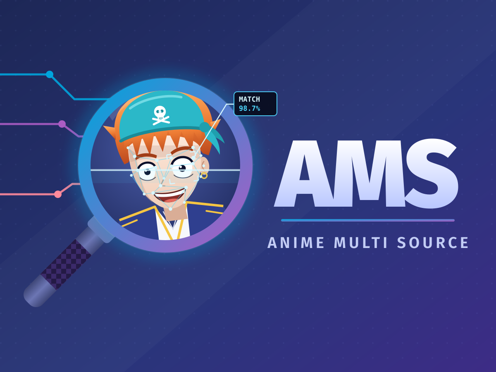

# Anime Multi Source (Jellyfin plugin) — Jellyfin 12 fork



**✅ Works with Jellyfin 12.2** (tested on 12.2.0) · **TV series and movies** · .NET 10, plugin ABI 12.0.0.0

Remote anime metadata, tags, artwork and people for Jellyfin, combined from multiple sources (AniList, AniDB, Jikan/MAL, TVDB, Fanart.tv, Fribb mappings and `.plexmatch` files). Built for large libraries with cautious rate limiting and persistent caching.

> **This is a fork.** Anime Multi Source was created by **[webbster64](https://github.com/webbster64)** — see the [original repository](https://github.com/webbster64/jellyfin-plugin-AnimeMultiSource). The original targets Jellyfin 10.11 and anime series. This fork brings it to **Jellyfin 12.x**, adds **movie support**, and adds the quality-of-life features listed below. All credit for the original plugin and its design goes to webbster64 and its contributors.

## What's new in this fork
- **Jellyfin 12.2 support:** rebuilt for .NET 10 and the Jellyfin 12.2 packages, and tested end to end on a 12.2.0 server (series, seasons, episodes, movies, scheduled tasks).
- **Movies:** anime films in a *Movies* library now get the same metadata as series. See [Movies](#movies).
- **Sync settings:** auto sync every 3 hours to a week (or off) plus a **Sync now** button. Fills in shows and movies that haven't been processed yet, refreshes tags of recently aired shows and updates upcoming episodes, with a progress bar and a summary in *Dashboard → Activity*. See [Sync](#sync).
- **Badge:** an *Anime Multi Source* tag on every show and movie the plugin updates. See [Badge](#badge).
- **Progress in the log:** one line per show or movie, with what was found, how long it took, and running totals.
- **Settings in the sidebar:** *Anime Multi Source* is listed under *Plugins* in the dashboard's left sidebar.
- **Cast language:** keeps the original-language voice cast and only adds a dub's cast when your files have that audio track. See [Cast language](#cast-language).
- **Faster when MAL is down:** Jikan requests time out after 15 s instead of 100 s, and Jikan is skipped for 10 minutes after repeated failures (AniList fills in).
- **Fixes:** TMDb movie ids from Fribb (previously crashed the parser), movie runtimes ("1 hr 46 min" was read as 46), External ID labels ("Movie Id" vs "Series Id"), no duplicate AniList field or link when the official AniList plugin is installed, and no wrong anime links on people.
- **New logo.**

## Features
- Multi-source IDs: resolves AniList, AniDB, MAL, TVDB, TMDB, IMDb, Kitsu, AniSearch via Fribb mappings plus optional `.plexmatch` overrides. Fills gaps in Fribb's data from `manami-project/anime-offline-database` and (optionally) AnimeSchedule.net, for titles Fribb hasn't fully cross-referenced yet.
- Metadata: titles, descriptions, genres, studios, scores, relations/seasons, people (voice actors/staff), tags (AniDB, with AniList's relevant non-spoiler tags as a fallback when AniDB has none) — for series, seasons, episodes and movies.
- Images: Fanart.tv + TVDB backdrops, posters, logos and season art, with quality filters and limits.
- Upcoming episodes: optional AnimeSchedule.net integration populates Jellyfin's built-in "Upcoming" tab with real sub/dub-aware air dates. See [AnimeSchedule.net](#animeschedulenet-upcoming-episodes).
- Localized libraries: season folders named in other languages (e.g. French "Saison 1") resolve correctly; numbered season titles and TVDB episode translations follow Jellyfin's configured display language.
- Rate limits and backoff: AniList (30/min), Jikan (spacing, retry-after, fast-fail), AniDB (soft cap with backoff and ban detection).
- Persistent caches: AniDB and AniList responses cached up to 5 days and persisted to disk to survive restarts.

## Requirements
- **Jellyfin 12.0 or newer** (tested on 12.2.0). For Jellyfin 10.11, use the [original plugin](https://github.com/webbster64/jellyfin-plugin-AnimeMultiSource).
- API keys (all optional but recommended):
  - Fanart.tv personal API key (logos/backdrops — without one, this plugin's Fanart.tv images are skipped)
  - AnimeSchedule.net API key (Upcoming episodes; from your AnimeSchedule.net account settings, API tab)

### .plexmatch files (strongly recommended for series)
- Series are identified from a `.plexmatch` file in the series folder (not in the season folders). Supported fields: `title`, `year`, `tvdbid`, `imdbid`, `tmdbid`, and `anilistid`/`malid`.
- `anilistid`/`malid` let a title resolve directly from AniList/MAL even when Fribb hasn't cross-referenced it to a TVDB/IMDb id yet (common for brand-new simulcasts).
- Sonarr can write them for you: **Settings → Metadata → Plex**, enable it and tick **Series Plex Match File**, then run **Update All** on the Series page.

## Installation
**Option 1: Plugin repository**
1. Jellyfin Dashboard → Plugins → Repositories.
2. Add repository: Name `AnimeMultiSource (Jellyfin 12)`, URL `https://raw.githubusercontent.com/doogalbeez/jellyfin-plugin-AnimeMultiSource/main/manifest.json`.
3. Go to Catalog, find **Anime Multi Source**, click Install.
4. Restart Jellyfin, then hard-refresh the browser (Ctrl+Shift+R / Cmd+Shift+R).

**Option 2: Manual install from a release**
1. Download the latest zip from this fork's [releases](https://github.com/doogalbeez/jellyfin-plugin-AnimeMultiSource/releases).
2. Extract it into a folder in your Jellyfin plugins directory, e.g. `plugins/AnimeMultiSource_<version>/` (it contains the DLL, `meta.json` and `logo.png`).
3. Restart Jellyfin.

**Option 3: Build from source**
1. `dotnet build -c Release` in the repo root (needs the .NET 10 SDK).
2. Copy `Jellyfin.Plugin.AnimeMultiSource/bin/Release/net10.0/Jellyfin.Plugin.AnimeMultiSource.dll` into a folder in your Jellyfin plugins directory.
3. Restart Jellyfin.

## Configuration
Open **Dashboard → Plugins → Anime Multi Source** (also in the dashboard sidebar):
- Titles: choose the field (English/Romaji/Japanese) and source. **AniList** is the most reliable source; "AniDB" as a title source falls back to MAL then AniList.
- Enter a Fanart.tv personal key (logos/backdrops).
- Set AniDB client name/version.
- Configure backdrop limits/quality, cast language, and movie title search.
- Approved genres: prefilled with a curated list; edit or clear as needed (one genre per line).

### Metadata and image providers
- In your anime library settings, tick **AnimeMultiSource** under **Metadata downloaders** for Shows, Seasons and Episodes (and **AnimeMultiSource Fanart.tv** / **AnimeMultiSource TVDB Episode Images** under Image fetchers), and move them to the top.
- Avoid enabling separate AniDB and AniList metadata plugins alongside it, so they don't add duplicate provider IDs.
- **Missing Episode Fetcher** can remain enabled.

### Movies
Tick **AnimeMultiSource** under **Metadata downloaders (Movies)** in your movie library. A film is identified in this order:
1. An AniList or MAL id already on the item (e.g. typed into *Edit metadata → External IDs*, or read from the `movie.nfo` Jellyfin saved earlier). With **Metadata savers → Nfo** ticked in the library, matches are written to `movie.nfo` and survive a database rebuild or a move to a new server.
2. A `.plexmatch` in the movie's folder (`anilistid`, `malid`, `tmdbid` or `imdbid`).
3. A TMDb or IMDb id on the item — from folder tags like `[tmdbid-916224]`, a Radarr `movie.nfo`, or TheMovieDb ranked above this plugin — matched against Fribb's anime **movie** entries.
4. As a last resort, a strict AniList title search (movies, OVAs, specials and ONAs): exact title and release year within one. Turn it off with **Identify movies by title when they have no IDs** if your library mixes anime and live-action films.

Non-anime films are left untouched for TheMovieDb. *Identify* on a movie also lists AniList results. Runtime comes from the file itself (Jellyfin 12 always uses the real file length for videos).

### Cast language
**Voice actors to add to Cast & Crew** (default: *Original language + dubs matching the file's audio tracks*): the original cast comes from the anime's country of origin (Japanese for Japanese anime). A dub's cast, e.g. English, is only added when an episode or movie file has an audio track in that language, and is labelled e.g. "Frieren (English dub)". Other options: *Original language only*, or *Every dub*. A new series' episodes are read after the series metadata, so its dub cast appears from the next refresh.

### Sync
**Dashboard → Plugins → Anime Multi Source → Sync** controls the plugin's background work:
- **Auto sync:** Off, or every 3 / 6 / 12 (default) / 24 hours, 3 days or a week. Longer intervals mean fewer API calls.
- **Sync now:** runs a sync straight away (also under **Dashboard → Scheduled Tasks → Anime Multi Source → Sync anime metadata now**).

A sync is built for big libraries: it never refreshes everything, only what needs it, one title at a time:
1. Shows and movies in a library that uses this plugin but have no AniList/AniDB/MAL ids yet. Titles with no anime match are only retried by **Sync now**, so a library that mixes anime and live-action films isn't re-refreshed on every run.
2. Series whose last episode arrived about a week, then about 3 months, ago get a refresh, because AniDB/MAL tags fill in slowly. A new season starts this over. Films get the same two refreshes, counted from the day they were added to the library, if they were released in the last 3 years (a new film often has only general AniDB tags at first; older films are skipped so importing a back catalogue doesn't trigger thousands of refreshes).
3. AnimeSchedule.net upcoming episodes for every mapped series (when a key is set). Placeholder `TBA` episodes are removed once they air or the real file arrives.

One failing title never stops the run. The log shows `[3/57] Title: filled in (6.2s), about 4m left`, and a summary, including titles with no anime match, goes to **Dashboard → Activity**. The **Auto sync anime metadata** task wakes up hourly and only does work when the chosen interval has passed.

### Badge
Every show and movie the plugin updates gets the tag **Anime Multi Source**, listed under *Tags* on its page and usable as a library filter, so you can see at a glance what it has handled. Turn it off under **Sync**; existing badges are removed on the next sync. (Jellyfin's web client has no place for a plugin to add a logo next to the rating icons, so the badge is a tag.)

Every series/movie refresh also logs one line such as:
```
AnimeMultiSource OK Movie "Kimi no Na wa." in 4.4s - AniList 21519, 31 tags, 54 people | 12 updated since startup, avg 5.1s
```

### AnimeSchedule.net (Upcoming episodes)
Optional. Adds mapped anime to Jellyfin's built-in **Upcoming** tab (`Shows → Upcoming`) with real air dates, and backstops title/overview/id resolution when Fribb/Jikan/AniList come up short for a title.

1. Get an API key from your AnimeSchedule.net account settings (API tab).
2. Enter it under **Dashboard → Plugins → Anime Multi Source → AnimeSchedule.net**, and choose a schedule: **Sub**, **Dub**, or **Combined** (prefers dub, falls back to sub per episode if no dub exists).
3. Leave the key blank to disable the feature entirely — nothing else changes.

Upcoming episodes refresh whenever a series is refreshed, and on every [sync](#sync), so schedule delays/reschedules between refreshes still get picked up. Episode titles show as `TBA` — AnimeSchedule is a scheduling calendar, not an episode database, so no title is ever made up.

## Rate limits & caching
- AniList: spaced to ~30 req/min; cached 5 days; persisted on disk.
- AniDB: at least 2 s between requests, shared by every part of the plugin; soft daily cap with slow mode; ban/limit responses trigger backoff; cached 5 days; persisted on disk.
- Jikan/MAL: spaced (~2.5 s) with retry-after; 15 s timeout; paused for 10 minutes after 3 failures in a row.
- Persistent cache file: `provider-cache.json` under the plugin data folder, saved at most once a minute and written safely (a crash never leaves a broken file). Entries older than 5 days are discarded automatically.
- Fribb mapping list: refreshed every 6 hours; a copy is kept in the plugin data folder, so a GitHub outage or a restart without internet doesn't stop metadata.

## Usage notes
- If AniDB is temporarily paused, tags are skipped for that window but metadata still completes; caching prevents repeat hits after the first successful fetch.
- Logs include per-item timing, rate-limit waits, cache hits, and any AniDB/Jikan backoff reasons to help diagnose slowdowns.

### File and folder naming
- Use standard season/episode naming: `Show Name/Season 1/Show Name - S01E12 - Title.mkv`. Avoid date/daily formats (e.g. `Show Name - 2022-03-23.mkv`), because Jellyfin/TVDB episode mapping will be skipped.
- Keep one series per folder with season subfolders (`Season 1`, `Season 2`, …). Place `.plexmatch` in the series root.
- If using Sonarr/Radarr, set the series type to "Standard" (not "Daily/Date") so files are named with `SxxEyy`.

## Troubleshooting
- Nothing happening for a show? Check it has a `.plexmatch` in its series folder and that AnimeMultiSource is ticked in the library settings. The log says `no plexmatch file` when it's missing.
- No tags? Check the logs for AniDB backoff messages; waits clear automatically.
- Log says `No AniDB tags for <title>; using N AniList tags instead`, but the AniDB page shows tags? Newer titles often only have general category tags on AniDB yet (e.g. *shounen*, *manga*, *fantasy*, *Japanese production*), and the plugin filters those out because Genres already cover them, so AniList's tags are used. Nothing is blocked: the plugin uses AniDB's data API, not the website, so the website's browser check doesn't apply. Films released in the last 3 years are refreshed automatically about a week and about 3 months after being added; for anything else, refresh the item once AniDB users have added specific tags (AniDB data is cached for 5 days).
- Fanart/TVDB images missing? Verify keys and that the item has a TVDB ID.
- Movie has the *Anime Multi Source* badge but TheMovieDb's title and overview? Jellyfin takes each field from the first metadata downloader that has it (tags are combined from all), so move **AnimeMultiSource** to the top of the library's *Metadata downloaders (Movies)*, then refresh the library with **Replace all metadata**. `tools/check_movies.py` in the dev repo checks the order and lists movies without anime ids.
- How do I know it worked? Look for AniDB/Kitsu/AniSearch/MAL links under the item's External IDs, and a long list of anime tags.
- Jellyfin unreachable in Docker (e.g. on Unraid) although the container shows *healthy*, and the log is full of `Resource temporarily unavailable (<host>:443)`? The container has lost its network: nothing can reach it and it can't look anything up, so every metadata lookup fails too. This is Docker, not Jellyfin or this plugin. Check it with:
  ```
  docker inspect -f '{{json .NetworkSettings.Ports}}' <container>
  docker exec <container> getent hosts api.anidb.net || echo "no DNS inside the container"
  ```
  `{}` (no published ports) plus no DNS confirms it. Restarting the Docker service usually fixes it without a reboot (Unraid: *Settings → Docker → Enable Docker: No → Apply*, then *Yes → Apply*). Afterwards press **Sync now** to catch up on anything missed while it was offline.
- Slow first scan on huge libraries is expected; later scans benefit from caches. Press **Sync now** to catch anything skipped.

## Revision history
See [CHANGELOG.md](CHANGELOG.md) for full details.

| Version | Date | By | Highlights |
|---|---|---|---|
| **1.0.8.1** (fork) | 2026-10-28 | [doogalbeez](https://github.com/doogalbeez) | Catalog updates no longer leave the old version loaded next to the new one |
| **1.0.8.0** (fork) | 2026-10-28 | [doogalbeez](https://github.com/doogalbeez) | Sync settings (auto interval, Sync now), "Anime Multi Source" badge, AniDB rate-limit and cache fixes for large libraries, season/tag/Fanart.tv/TVDB/upcoming-episode fixes |
| 1.0.7.0 (fork) | 2026-10 | [doogalbeez](https://github.com/doogalbeez) | Jellyfin 12.2 support, movie provider, "Fill in missing anime metadata" task, per-item progress log, sidebar link, cast language setting, Jikan fast-fail, TMDb/runtime/External ID fixes, new logo |
| 1.0.6.14 | 2026-08-10 | [webbster64](https://github.com/webbster64) | AnimeSchedule Upcoming fixes for multi-season anime, status fixes, "Refresh Recently-Aired Anime Tags" task |
| 1.0.6.5 | 2026-08-10 | webbster64 | Self-healing stale plugin version folders, config recovery |
| 1.0.6.4 | 2026-08-10 | webbster64 | AnimeSchedule virtual episodes persisted, "Refresh AnimeSchedule Upcoming Episodes" task |
| 1.0.6.1 | 2026-08-09 | webbster64, [@Soitora](https://github.com/Soitora) | AnimeSchedule.net integration, `.plexmatch` anilistid/malid, localized seasons, offline-database backfill |
| 1.0.5.0 | 2026-06-16 | webbster64, [@techman83](https://github.com/techman83) | Fribb JSON parsing fix, IMDb support |
| 1.0.4.9 | 2026-06-16 | webbster64, [@theflanman](https://github.com/theflanman) | TMDb id handling, title language fallback |
| 1.0.0.0 – 1.0.4.8 | 2025-11 – 2026-01 | webbster64 | Original plugin and early releases |

## Credits
- **[webbster64](https://github.com/webbster64)** — creator of Anime Multi Source. [Original repository](https://github.com/webbster64/jellyfin-plugin-AnimeMultiSource).
- Contributors to the original: [@Soitora](https://github.com/Soitora), [@techman83](https://github.com/techman83), and [@theflanman](https://github.com/theflanman).
- Jellyfin 12 port, movie support and the features above: [doogalbeez](https://github.com/doogalbeez).
- Data: [AniList](https://anilist.co), [AniDB](https://anidb.net), [MyAnimeList](https://myanimelist.net) via [Jikan](https://jikan.moe), [TheTVDB](https://thetvdb.com), [Fanart.tv](https://fanart.tv), [Fribb/anime-lists](https://github.com/Fribb/anime-lists), [manami-project/anime-offline-database](https://github.com/manami-project/anime-offline-database), [AnimeSchedule.net](https://animeschedule.net).
- 🤖 This fork's Jellyfin 12 port, movie support, new features, testing and logo were made with the help of **[Claude Code](https://claude.com/claude-code)**, Anthropic's AI coding assistant.

## License
GPLv3 (matches Jellyfin plugin requirements). This fork keeps the original GPLv3 license.
